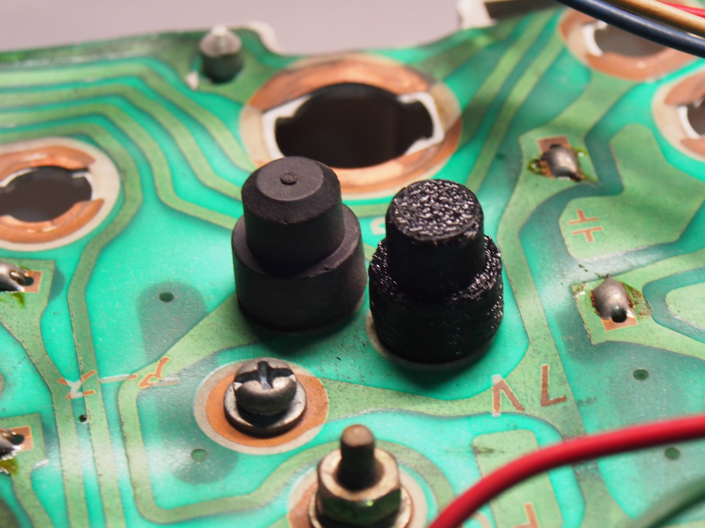

# Suzuki Samurai instrument cluster bolt cap

A cap for the bolt behind the instrument cluster, so it cannot short against whatever metal sits behind the dash. The original is a rubber-like molded cap; this is a printed stand-in, press-fit over the same bolt.

## The part

|  |  |
|---|---|
| Size | about 12 mm diameter x 13 mm tall |
| Drawn in | FreeCAD 1.0 |
| Fitment | Confirmed on my own 1986 Samurai. If yours is a different market or year, measure first. |

## Printing

|  |  |
|---|---|
| Material | TPU |
| Layer height | slicer default |
| Infill | slicer default |
| Walls | slicer default |
| Orientation | printed upside down |
| Supports | yes |

**Print it in TPU.** It needs to be flexible enough to press-fit tight over the bolt, the way the original rubber cap does. A rigid material would either not grip or crack going on.

Everything else can stay at your slicer's defaults.

## Fitting

Press it on over the bolt. It should go on tight; that is the point.

## Files

| File | What it is |
|---|---|
| `instrument-cluster-bolt-cap.3mf` | printable; carries its own units, so it lands in your slicer at the right size |
| `instrument-cluster-bolt-cap.step` | editable solid, opens in Fusion, SolidWorks, Onshape and the rest |
| `instrument-cluster-bolt-cap.FCStd` | FreeCAD source, the original |

If you want to change a dimension, start from the STEP or the FreeCAD file. The 3MF is a mesh: it prints well and edits badly.

There is no STL here on purpose. Every current slicer reads 3MF, and keeping one printable file means there is never a stale copy of this part floating around.

## License and warning

[CC BY-SA 4.0](../../LICENSE). Attribution to Malcolm Davis Steele; keep derivatives under the same license.

No warranty. This one covers a bolt behind a live instrument cluster: check your own print before you rely on it.
